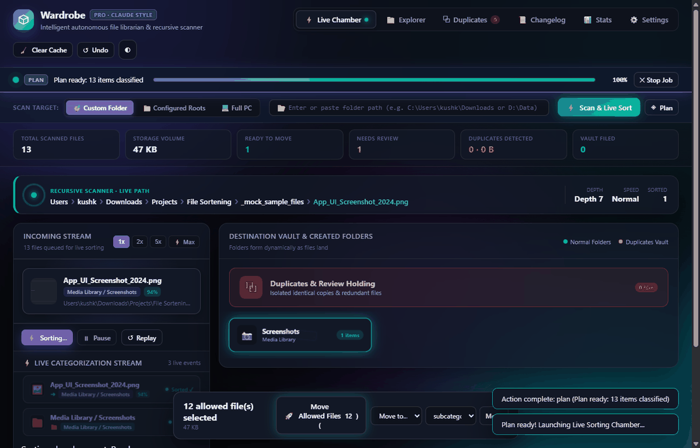

# ⚡ Wardrobe — Intelligent Semantic File Organizer & Live Control Room

[](https://www.python.org/)
[](https://opensource.org/licenses/MIT)
[]()
[]()
[](https://github.com/Kushkc007/Wardrobe/actions/workflows/tests.yml)

> **A human-centric, deterministic file organizer with a real-time web dashboard.**  
> It reads your messy folders, understands what each file is **actually for**, and organizes everything into meaningful categories (e.g. `Money & Paperwork/Invoices & Receipts`, `Work & Clients/Contracts`, `Personal & Life/Identity`) — instead of useless dumping grounds like `PDF/`, `Images/`, or `2024/`.

<br/>

<div align="center">
  
  <p><em>Real-Time Live Sorting Chamber and Interactive Move Validation Control Room</em></p>
</div>

---

## 📑 Table of Contents

1. [What is Wardrobe? (Project Overview)](#-what-is-wardrobe)
2. [How It Works (Under the Hood)](#-how-it-works)
3. [Quick Start & Launch Options](#-quick-start)
   - [Option A: Standalone .EXE (No Python Needed)](#option-a-standalone-executable-wardrobeexe)
   - [Option B: 1-Click Launcher (Windows `start.bat`)](#option-b-1-click-launcher-startbat)
   - [Option C: Command Line Interface](#option-c-command-line-interface)
4. [How & Where to Connect (Configuration Guide)](#-how--where-to-connect-configuration-guide)
   - [1. 100% Offline Mode (Default — No Keys Required)](#1-100-offline-mode-default--no-keys-needed)
   - [2. Connecting Local AI (Ollama / LM Studio)](#2-connecting-local-ai-ollama--lm-studio)
   - [3. Connecting Cloud AI (OpenAI / Groq / OpenRouter)](#3-connecting-cloud-ai-openai--groq--openrouter)
   - [4. Setting Source Folders & Destination Vault](#4-setting-source-folders--destination-vault)
   - [5. Protecting Active Projects & Folders](#5-protecting-active-projects--workspaces)
   - [6. The Family Brain (person-first, user-defined)](#6-the-family-brain-person-first-user-defined-dynamic-folders)
5. [The Live Dashboard Control Room](#-the-live-dashboard-control-room)
6. [The Wardrobe Brain (`taxonomy.json`)](#-the-wardrobe-brain-taxonomyjson)
7. [Guaranteed Safety & Rollback](#-guaranteed-safety--rollback)
8. [Demo Mode](#-demo-mode)
9. [Repository Layout](#-repository-layout)
10. [Development & Tests](#-development--tests)
11. [Building the Standalone EXE](#-building-the-standalone-exe)

---

## 🧐 What is Wardrobe?

Most file organizers dump files by extension (`.pdf`, `.jpg`) or modification date. That doesn't solve clutter — it just creates a second organized mess. 

**Wardrobe is different:**
- **Understands Content:** It extracts embedded text from PDFs, Word docs (`.docx`), Excel sheets (`.xlsx`), PowerPoint decks (`.pptx`), and plain text/code.
- **Understands Images:** It reads EXIF metadata, aspect ratios, and resolution to separate genuine camera photos from screenshots, memes, and wallpapers without needing heavy vision models.
- **Reads Scanned Paper:** Integrates with Tesseract OCR to read text inside scanned physical invoices and paper receipts.
- **Deterministic & Safe:** The AI/classifier only suggests labels. Real file movements are handled by strict, verified Python code with automatic name-collision protection (`invoice (2).pdf`) and an atomic rollback journal.
- **Never Deletes:** Wardrobe **never** deletes your original files.

---

## ⚙️ How It Works

```
                               ┌────────────────────────────────────────────────┐
                               │             Source Folders (Roots)             │
                               │  (@downloads, @desktop, @documents, custom)    │
                               └───────────────────────┬────────────────────────┘
                                                       │
                                            Fast Recursive Scanner
                                       (Detects & Preserves Git Repos)
                                                       │
                                ┌──────────────────────┴──────────────────────┐
                                ▼                                             ▼
                     Embedded Text Extractor                        Media Provenance Analyzer
                   (PyMuPDF / docx / xlsx / txt)                     (EXIF, aspect ratio, dims)
                                │                                             │
                                └──────────────────────┬──────────────────────┘
                                                       │
                                            Two-Tier Classification
                                                       │
                       ┌───────────────────────────────┴───────────────────────────────┐
                       ▼                                                               ▼
             Tier 1: Rules Engine (Default)                               Tier 2: Optional LLM
         - 100% offline, zero latency                                 - Ollama (Local) or OpenAI/Groq
         - Token-based weighted scoring                               - Triggered only when enabled
         - Provenance & kinship detection                             - Auto-fallback to rules on error
                       │                                                               │
                       └───────────────────────────────┬───────────────────────────────┘
                                                       │
                                        Move Validation & Staging
                                 (User reviews & unchecks unwanted moves)
                                                       │
                                    Safe Execution & Transaction Journal
                                        Destination: ~/Organized
```

---

## 🚀 Quick Start

Choose whichever launch option fits your style:

### Option A: Standalone Executable (`Wardrobe.exe`)
*Best for users who want zero installations or do not have Python installed.*
1. Download the latest `Wardrobe.exe` from the [Releases](https://github.com/Kushkc007/Wardrobe/releases) page.
2. Double-click **`Wardrobe.exe`**.
3. It immediately starts the local server and opens your web browser to `http://127.0.0.1:8765`.

### Option B: 1-Click Launcher (`start.bat`)
*Best for Windows users running from the source repo.*
1. Double-click **`start.bat`** in the project folder.
2. It automatically checks Python, installs missing packages from `requirements.txt`, launches the dashboard, and pops open your browser.
*(On macOS / Linux, run `./start.sh`)*

### Option C: Command Line Interface
*Best for terminal power users and automated scripts.*
```bat
organize.cmd scan        :: Scan roots and generate inventory
organize.cmd plan        :: Classify files and generate plan.json + review board
organize.cmd apply       :: Move files to their destination vault
organize.cmd undo        :: Instantly reverse the last move operation
organize.cmd audit       :: Find duplicate files and empty directories
organize.cmd watch       :: Background watcher that files new arrivals automatically
organize.cmd dashboard   :: Start the interactive web dashboard on localhost
```

---

## 🔌 How & Where to Connect (Configuration Guide)

All settings are controlled by **`config.toml`**. On the first run it is created
automatically from `config.example.toml`; you can then edit it with any text
editor (Notepad, VS Code, etc.). `config.toml` is intentionally git-ignored so
your personal paths never land in a commit.

### 1. 100% Offline Mode (Default — No Keys Needed)
By default, Wardrobe runs completely offline using its built-in rule engine:
```toml
[llm]
enabled = false # or "auto" without an API key
```
- **No API keys needed.**
- **No internet required.**
- Analyzes filenames, folder paths, document headers, and media metadata deterministically.

---

### 2. Connecting Local AI (Ollama / LM Studio)
If you want deep semantic classification without your data leaving your computer:

1. Install [Ollama](https://ollama.com/) and pull a lightweight model:
   ```bash
   ollama pull qwen2.5:7b
   ```
2. In `config.toml`, configure the `[llm]` section:
   ```toml
   [llm]
   enabled = true
   base_url = "http://localhost:11434/v1"
   model = "qwen2.5:7b"
   api_key_env = "OLLAMA_API_KEY" # Any dummy value works
   ```
Wardrobe will now query your local Ollama instance over localhost!

---

### 3. Connecting Cloud AI (OpenAI / Groq / OpenRouter)
If you prefer hosted models for ultra-high accuracy on difficult documents:

1. Get an API key from [OpenAI](https://platform.openai.com/), [Groq](https://groq.com/), or [OpenRouter](https://openrouter.ai/).
2. Set your environment variable in Windows:
   ```cmd
   setx OPENAI_API_KEY "sk-your-actual-api-key"
   ```
3. In `config.toml`:
   ```toml
   [llm]
   enabled = "auto" # Will activate automatically when key is detected
   base_url = "https://api.openai.com/v1" # Or https://api.groq.com/openai/v1
   model = "gpt-4o-mini" # Or llama-3.3-70b-versatile
   api_key_env = "OPENAI_API_KEY"
   ```

---

### 4. Setting Source Folders & Destination Vault

Open `config.toml`:
```toml
[general]
# Where sorted files will be organized
vault = "~/Organized"

# Folders to scan and organize.
# "@name" resolves real Windows shell paths (including OneDrive-redirected folders)
roots = [
  "@downloads",
  "@desktop",
  "@documents",
  "@pictures",
  "@videos",
  "@music",
  # "D:/MyCustomFolder" # You can add explicit paths too
]
```

---

### 5. Protecting Active Projects & Workspaces
Wardrobe has built-in project awareness:
- Any folder containing `.git`, `package.json`, `pyproject.toml`, `Cargo.toml`, etc., is recognized as a **Project Unit** and will **never** be dismantled into loose files.
- To keep specific workspaces completely off-limits, add them to `[protect]`:
```toml
[protect]
paths = [
  "~/Downloads/ActiveWork",
  "~/Videos/RawFootage",
]
```

---

### 6. The Family Brain (person-first, user-defined, dynamic folders)

Real family laptops are shared. Wardrobe treats **who a file belongs to** as the
first question, then asks **what the file is**. Nothing about your family or
your folders is hard-coded: you define people once in the dashboard's **Family**
tab (or in `family.json`), and every scan uses those definitions. Folder names
are not a fixed list either — they are learned from the files in the current
scan and created on the spot.

```toml
[general]
family_layout = true       # <Person>/<label learned from the file>/..., Common/...
detect_duplicates = true   # identical files are parked in Others/Duplicates
enable_face_recognition = true
```

**What you can define per person** (Family tab → Edit Family):

| Field | Example | Why it matters |
|---|---|---|
| Name | `Kushagra` | becomes the folder name |
| Relationship | `self`, `Father`, `Mother`, `Bua` | resolves Papa/Mummy/Bhai from filenames |
| Aliases | `Kush, Kushagra Chaturvedi` | catches short names and spellings |
| Employers | `R1, Rubix, GDR` | company becomes a subfolder under the learned label |
| Keywords | `batting, portfolio` | custom clues for hobbies or projects |
| Rules | match `mahagun` → `Father/Documents/Job/Mahagun` | your own overrides win |

The engine only chooses a person when the evidence is clear. It scores
name/alias hits, employer hits, custom keywords, document headers (resume,
Aadhaar, PAN, passport), face-recognition results, and parent-folder provenance.
If two people tie, the file goes to `Others/Review` instead of being guessed.

**Folder hierarchy is synthesised on the spot.** There is no fixed category
list. The learner reads each file and derives a label from the file itself:

| File in the scan | Learned label | Folder created |
|---|---|---|
| `Kush_R1_SalarySlip_Aug.pdf` | Salary Slip | `Kushagra/Salary Slip/R1/` |
| `Papa_Aadhaar.pdf` | Aadhaar | `Manoj Kumar Chaturvedi/Aadhaar/` |
| `property_papers_papa.pdf` | Property Papers | `Manoj Kumar Chaturvedi/Property Papers/` |
| `Manoj_Mahagun_Site_Report.xlsx` | Site Report | `Manoj Kumar Chaturvedi/Site Report/Mahagun/` |
| `NASA_JWST_Optical_Design.pdf` | NASA / James Webb Space Telescope | `Common/NASA/James Webb Space Telescope/` |
| `Kush_wedding_haldi.jpg` | Wedding / Haldi | `Kushagra/Photos/Functions/Wedding/Haldi/` |

Similar labels are clustered (`Salary Slip` / `Salary Slips`), and any new
phrase becomes a new folder on the first move. People folders are equally
dynamic: a detected person not yet in your profile gets their own folder, and
you can rename or merge it later from the dashboard.

```
~/Organized/
├── Kushagra/
│   ├── Photos/
│   │   ├── Personal/       (solo photos)
│   │   ├── With Others/    (group photos)
│   │   ├── Scenery/
│   │   ├── Functions/Wedding/Haldi/
│   │   └── Trips/Amritsar/
│   ├── Resume/
│   ├── Salary Slip/R1/
│   ├── Signature/
│   └── <any new label the files produce>/
├── Manoj Kumar Chaturvedi/
│   ├── Aadhaar/
│   ├── Property Papers/
│   └── Site Report/Mahagun/
├── Common/
│   ├── Books/  Passwords/  Screenshots/
│   ├── Greetings/Good Morning/  Greetings/Good Night/
│   ├── Greetings/Festivals/Diwali/
│   ├── Jokes & Memes/
│   └── Photos/Scenery/  Photos/With Others/
└── Others/
    ├── Review/             (unknown owner, kept safe)
    └── Duplicates/         (exact copies, never deleted)
```

The folder names above are examples produced by the current scan, not a
schema. Delete or rename them and the next scan learns the new names from the
files again.

**Duplicate safety:** only files that share a byte size are hashed, so large
scans stay fast. Exact duplicates are moved to `Others/Duplicates` with a
journal entry; the original stays in its proper person folder.

**Face recognition** (optional, offline): OpenCV YuNet + SFace clusters photos
by person and feeds the owner into the same hierarchy. When faces are not
detected, filename evidence and `family.json` still decide.

---

## 🎛️ The Live Dashboard Control Room

Running `start.bat` or `Wardrobe.exe` opens the web control room at **`http://127.0.0.1:8765`**:

1. **👨‍👩‍👧 Family Vault:** Person cards with file counts, a live folder tree, and a
   file-manager explorer. Click any person or folder to browse its contents.
   **Edit Family** lets you add people, aliases, employers, keywords and rules.
2. **⚡ Live Sorting Chamber:** An animated hopper with live speed controls (1x, 2x, 5x, Max) where you watch incoming files glide into dynamically generated category folders.
3. **📁 File Explorer & Validation Staging:**
   - View every file with its destination, preview thumbnail, and confidence score.
   - **Interactive Checkboxes:** All planned files are selected by default. Simply uncheck any file you wish to keep in place, then click **`[ 🚀 Move Allowed Files ]`**.
4. **⧉ Duplicates & Review Station:** Identifies duplicate copies across different folders using cryptographic hashes, allowing 1-click duplicate isolation.
5. **↺ Changes & Rollback Journal:** Complete audit trail of every file moved, with instant 1-click restoration.

---

## 🧠 The Wardrobe Brain (`taxonomy.json`)

The default taxonomy is organized into 10 intuitive human domains:

| Category | Primary Subcategories |
|---|---|
| **Money & Paperwork** | Taxes, Invoices & Receipts, Banking, Insurance, Salary, Loans |
| **Work & Clients** | Clients, Contracts, Deliverables, Meetings, Pitches & Decks |
| **Personal & Life** | Identity & Certificates, Health & Medical, Home & Bills, Travel |
| **Learning & Reference** | Courses, Books & Ebooks, Research Papers, Guides, Notes |
| **Media Library** | Camera Photos, Screenshots, Wallpapers, Personal Videos, Music |
| **Code & Development** | Repositories, Configs & Env, Databases, Scripts, Documentation |
| **Creative Projects** | Video Editing, YouTube & Shorts, Graphic Design, Audio Assets |
| **Installers & Software** | Software Installers, Drivers, License Keys |
| **Archive & Old** | Old Versions, Zip Bundles |
| **Unsorted** | Needs Review (Safety buffer for ambiguous files) |

You can customize categories, subcategories, and keywords at any time by editing `taxonomy.json`.

---

## 🛡️ Guaranteed Safety & Rollback

- **No Overwriting:** If `Report.pdf` already exists in the destination, Wardrobe names the new file `Report (2).pdf`.
- **Atomic Journaling:** Every move is recorded in `state/undo-<timestamp>.json`. Running `organize.cmd undo` or clicking **Undo** in the dashboard reverses the move file-by-file.
- **Project Preservation:** Software repositories and complex projects are never taken apart.
- **Zero Cloud Uploads by Default:** Operates strictly on localhost (`127.0.0.1`).

---

## 🔨 Building the Standalone EXE

A pre-compiled standalone **`Wardrobe.exe`** (requiring zero setup or Python
installation) is available under the [Releases](https://github.com/Kushkc007/Wardrobe/releases)
tab. Download it and double-click to run.

To build it yourself, install PyInstaller and run:

```bash
pip install pyinstaller
pyinstaller Wardrobe.spec
```

The build output goes to `dist/` (git-ignored).

---

## 🧪 Demo Mode

The repository ships with a disposable demo so you can see the whole engine
without opening your real Downloads folder.

```bash
# 1. Build a sample Inbox + its own config and family profile
python demo_live_setup.py

# 2. Start the dashboard against the demo config (separate port)
#    Windows PowerShell:
$env:WARDROBE_CONFIG="demo_live/config.toml"; $env:WARDROBE_PORT="8899"; python -m dashboard.app
#    Git Bash / macOS / Linux:
WARDROBE_CONFIG=demo_live/config.toml WARDROBE_PORT=8899 python -m dashboard.app
```

Then open **http://127.0.0.1:8899**.

- `demo_family_sort.py` runs a headless scan → plan → apply on 20 sample files
  and prints the before/after tree.
- `demo_present.py` drives a visible guided tour of every dashboard tab.
- Everything is written to `demo_live/` (git-ignored); your real vault and
  `family.json` are untouched.

---

## 📁 Repository Layout

```text
Wardrobe/
├── organize.py              # CLI entry point (scan / plan / apply / undo / watch / dashboard)
├── organizer/
│   ├── config.py            # config loading, first-run config creation
│   ├── scanner.py           # recursive scanner + project/archive awareness
│   ├── doc_intel.py         # document text, entities, people, topics
│   ├── labels.py            # on-the-spot folder-label learner (no fixed tree)
│   ├── family.py            # person-first routing, aliases, common/duplicate rules
│   ├── planner.py           # plan builder, duplicate hashing, destination synthesis
│   ├── apply.py             # safe moves + undo journal
│   ├── rules.py             # offline taxonomy rule engine
│   ├── photo_intel.py       # EXIF, faces, screenshots, WhatsApp junk
│   ├── ocr.py / textract.py # optional OCR / document text extraction
│   └── report.py            # HTML review board
├── dashboard/
│   ├── app.py               # Flask API + live job runner
│   ├── templates/index.html # single-page control room
│   └── static/              # app.js + style.css
├── tests/                   # 72 offline tests (pytest)
├── demo_*.py                # safe demo scripts
├── config.example.toml      # copy is auto-created as config.toml
├── taxonomy.json            # fallback taxonomy when family_layout is off
└── .github/workflows/       # CI: tests + critical lint
```

---

## 🛠️ Development & Tests

```bash
python -m venv .venv
# Windows: .venv\Scriptsctivate
# macOS/Linux: source .venv/bin/activate

pip install -r requirements.txt pytest ruff
python -m pytest tests -q
node --check dashboard/static/app.js
ruff check organizer dashboard organize.py --select F,E9
```

The test suite is fully offline and uses temporary directories. It covers the
scanner, document intelligence, dynamic labels, family routing, duplicates,
apply/undo, media and person documents.

### Privacy / commit hygiene

Never commit:

- `config.toml` (personal paths)
- `family.json` (real names, aliases, employers)
- `state/`, `reports/` (inventories, plans, move journals)
- API keys or `.env`

These are already in `.gitignore`. The CI does not need any of them.

---

## 📄 License

This project is licensed under the [MIT License](LICENSE). Feel free to use, modify, and distribute it freely.
